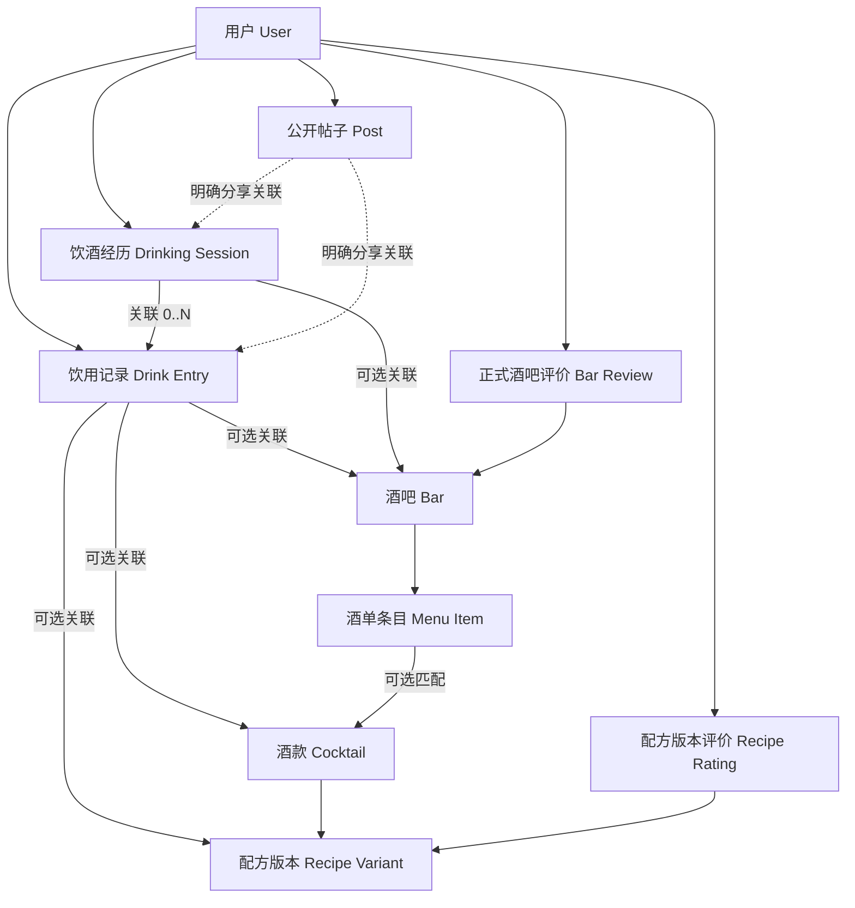

> **归档说明（2026-10-17）**：此文件保存此前交付的完整 v0.1 规划底稿，原文不改，仅在顶部增加归档提示；它不是最新实施基线。最新 A「城市极简」及品牌色 `#82442F` 等决定见 [产品开发基线](../product-baseline.md)、[A 视觉规范](../ui-a-minimal-spec.md) 和 [小程序开发路线](../wechat-dev-roadmap.md)。

# 酒迹｜完整产品规划（供审阅修改）

> **文档版本**：v0.1 · 2026-10-17  
> **用途**：产品总体规划 / PRD 草案 / 研发拆分基础 / 用户审阅修改底稿  
> **项目**：酒迹（Jiuji BarMap）  
> **仓库**：[crazyname/jiuji-barmap](https://github.com/crazyname/jiuji-barmap)  
> **文档性质**：这是在既有 GitHub 设计文档与最新需求访谈基础上，补齐缺口形成的**整体提案**；不是全部已确认的产品决定，也不表示任何尚未实现的功能已经上线。  
> **操作状态**：**仅交付本 Markdown 文件，未提交 GitHub、未修改应用代码。**

## 如何修改这份规划

全文用三种状态标识：

- **[已确认]**：此前讨论中用户明确确认，或由该决定直接推出的必要业务边界。
- **[建议]**：本次由规划者补全的产品、交互或技术方案；你可以任意改掉。
- **[待裁定]**：早期决策发生冲突，或尚未明确到足以开发；不要在你审阅前直接交给开发实施。

**裁定优先顺序**：[已确认的最新用户决定] → [审阅后批准的本文件] → [旧 GitHub 决策文档] → [本文建议细节]。旧决策保留可追溯性，但冲突项不能混作现行需求。

**本次重审重点**：过去选过「打卡默认公开」和「快速星级自动提交正式酒吧评价」。最新方向明确「个人记录默认私人，分享由本人主动决定」。因此本文**建议撤销旧默认公开与自动评分联动**，将普通饮酒记录和正式公开评价分开；这是一条**待你最终批准的变更建议**，不是擅自声称你已逐项批准。

---

## 目录

1. [产品定位、边界与体验原则](#一产品定位边界与体验原则)
2. [用户画像与真实使用场景](#二用户画像与真实使用场景)
3. [信息架构、导航和页面清单](#三信息架构导航和页面清单)
4. [核心模块 A：个人饮酒记录](#四核心模块-a个人饮酒记录)
5. [核心模块 B：鸡尾酒知识库与调酒](#五核心模块-b鸡尾酒知识库与调酒)
6. [核心模块 C：酒吧地图与发现](#六核心模块-c酒吧地图与发现)
7. [核心模块 D：社区、关系与内容](#七核心模块-d社区关系与内容)
8. [评价体系及个人记录的边界](#八评价体系及个人记录的边界)
9. [酒单、活动、商家与运营后台](#九酒单活动商家与运营后台)
10. [完整用户路径与交互规范](#十完整用户路径与交互规范)
11. [数据模型与权限方案](#十一数据模型与权限方案)
12. [技术架构、同步与迁移](#十二技术架构同步与迁移)
13. [内容质量、版权、隐私与合规](#十三内容质量版权隐私与合规)
14. [视觉、无障碍与体验性能](#十四视觉无障碍与体验性能)
15. [版本范围与开发排期](#十五版本范围与开发排期)
16. [验收用例及产品指标](#十六验收用例及产品指标)
17. [运营、收入与成本评估](#十七运营收入与成本评估)
18. [风险、取舍与决策清单](#十八风险取舍与决策清单)
19. [开发任务分解和交付条件](#十九开发任务分解和交付条件)
20. [源文档与术语](#二十源文档与术语)

---

## 一、产品定位、边界与体验原则

### 1.1 一句话定位

**[建议] 酒迹是一款围绕鸡尾酒与酒吧体验的个人记录、知识查询、地点探索和兴趣交流应用。**

它不需要成为通用本地生活平台，也不应为内容曝光、交易额或商家付费牺牲个人用户的日常体验。

### 1.2 四个核心价值

| 用户想做的事 | 酒迹要回答的问题 | 产品模块 | 优先程度 |
| --- | --- | --- | --- |
| 记住喝过什么 | 这杯是什么？上次在哪喝？味道如何？ | 个人饮酒记录 | 最高 |
| 找一杯酒或自己调 | 有什么配方？我有哪些材料？怎么调？ | 鸡尾酒知识库与调酒 | 最高 |
| 找地方喝酒 | 附近哪里值得去？是否符合自己的偏好？ | 酒吧地图与发现 | 高 |
| 看别人分享、交流 | 别人喝到了什么、做出了什么？ | 社区 | 高，但不阻碍前三项 |

### 1.3 非目标

**[建议] 不为了功能数量而做以下事情：**强制把每次饮酒变成社交内容、用连续饮酒签到刺激使用频率、把个人私密评价直接转为公开商家分数、制造不透明的付费排序、把商家营销功能挤进普通用户首屏、首版自建预订交易与酒类电商。

**[已确认]** 站内订座、支付、票务不是已确定的 1.0 范围；活动高级日历、关注提醒和订阅通知整体放到 1.0 之后。**[建议]** 酒类销售、即时配送、线下支付和现场社交匹配暂不规划。

### 1.4 产品原则

1. **记录先于发布**：能够在不公开、不评分、不发帖的情况下完成一条真实可回顾的记录。
2. **事实、体验和观点分离**：知识库事实、酒吧事实、个人口味、公共评分分别建模。
3. **不强迫填写**：可先记下酒名或选中酒款，详细字段以后补。
4. **不替用户编造事实**：酒吧坐标、价格、营业、配方来源和用户到访证据均不能靠猜测补足。
5. **数据归用户控制**：默认私人、能够编辑与删除、明确分享状态，最终支持导出。
6. **内容与商业保持独立**：广告可识别、不能付费改写自然评分或购买真实体验标签。
7. **能力跨模块复用**：记录、探店、酒款、配方、公开帖子之间通过关联衔接，而非存四份互不一致的文本。
8. **每一阶段能够独立使用**：没有社区增长，个人记录、配方查询和地图也应能成立。

---

## 二、用户画像与真实使用场景

### 2.1 核心用户（假设，待验证）

| 群体 | 首要任务 | 最重要的产品感受 |
| --- | --- | --- |
| 偶尔去酒吧的人 | 找店、看酒单、留下回忆 | 好找、不复杂、信息可信 |
| 经常尝试鸡尾酒的人 | 比较同款酒在不同地点的体验 | 记录不丢、酒款能归集 |
| 家庭调酒爱好者 | 看配方、调整用量、记作品 | 版本清楚、用量准确、可复用 |
| 分享型酒友 | 发探店笔记、展示作品、交流 | 编辑方便、有同好、互动不嘈杂 |
| 酒吧从业者与主理人 | 核实店铺信息、维护菜单与活动 | 可管理、有纠错渠道、无需买曝光 |

**[建议]** 首轮用户测试先覆盖前三类，不以商家账号数或社区粉丝量来决定产品是否有价值。

### 2.2 典型任务

**场景 S1：快速记一杯。** 用户在酒吧喝到一杯叫不出标准名字的特调：点击「＋」→ 记一杯 → 输入酒单上的名字（可拍照）→ 保存私人记录。整个过程不要求选酒吧、上传凭证或发表评分。

**场景 S2：一晚喝三杯。** 用户在同一酒吧喝三杯：可以先新建一次探店并连续添加，也能先分开记三杯、回家再关联到同一次探店。系统不能因日期或酒吧相同就擅自合并。

**场景 S3：多次喝同款。** 用户三次喝尼格罗尼，分别在两家店和自己家中；时间轴有三条记录，「我的酒款」里能看到一份归集档案，按时间、配方版本和场景回看。

**场景 S4：照着配方自己调。** 用户查玛格丽特，浏览不同版本、根据杯型调整份量，完成后把配方版本关联到个人制作记录，而不是自动发表一份新配方。

**场景 S5：找适合自己的酒吧。** 用户按商圈、价格带、酒吧类型、是否禁烟和氛围筛选，打开真实地点详情，查看更新时间与可靠来源，必要时跳出使用地图导航。

**场景 S6：主动分享。** 用户选择一条私密记录 → 分享到社区 → 补标题和公开图片 → 预览 → 明确发布。原始私人记录仍留在自己的日记里；分享是否持续同步应有单独规则。

**场景 S7：推荐缺失酒吧。** 用户地图上找不到某家店，可提交店名、线索和位置待核实信息。审核完成前不得虚构精确地图点位。

**场景 S8：浏览而不登录。** 游客可查看公开酒吧、公开配方和社区帖子；收藏、私密同步及投稿则引导正常登录，不展示开发 API 或测试令牌。

---

## 三、信息架构、导航和页面清单

### 3.1 顶层导航

**[已确认的既有方向]** 四个常驻栏目：`地图｜调酒｜社区｜我的`，中间有全局「＋」操作入口。它是操作按钮，不是第五个真正的 Tab。

**[建议调整]** 把中央「＋」从“全是公开发布的入口”改为“先记录、再创作和分享”的入口：

```text
地图            调酒            ＋            社区            我的
发现酒吧        查酒/配方       快捷操作         公开交流         私人空间

按「＋」：
  第一组：记一杯酒  /  记一次探店
  第二组：写分享笔记  /  发布调酒作品
  第三组：推荐新酒吧  /  写正式酒吧评价（可从店铺详情进入）
```

说明：**[待裁定]** 旧版曾固定「＋」五项：打卡、写评价、发笔记、分享调酒作品、推荐新酒吧。本提案把快捷私人记录放到前面，具体保留 5 项还是 6 项、是否将正式评价留在酒吧页，需要你审阅。**不要仅因为点击「＋」就默认进入公开发布。**

### 3.2 页面树（目标结构）

```text
酒迹
├─ 地图
│  ├─ 地图与列表 / 搜索与筛选
│  ├─ 酒吧详情
│  │  ├─ 介绍、营业与地址、导航、收藏
│  │  ├─ 结构化酒单与酒款跳转
│  │  ├─ 公开评价及体验标签
│  │  ├─ 公开帖子 / 活动 / 预约外链
│  │  └─ 记一次探店 / 写正式评价 / 纠错
│  └─ 收藏酒吧 / 想去清单 / 编辑专题（后续）
├─ 调酒
│  ├─ 酒款搜索与浏览
│  ├─ 酒款详情（概念与别名）
│  │  ├─ 配方版本列表
│  │  └─ 版本详情（配料、步骤、杯型、作者、来源）
│  ├─ 原料筛选 / 份量调整
│  ├─ 我的私密配方 / 创作与改编
│  └─ 开始调制 → 保存为个人饮用记录
├─ 社区
│  ├─ 图文瀑布流 / 搜索 / 关注（分期）
│  ├─ 帖子详情 / 评论 / 收藏 / 分享
│  ├─ 用户的公开主页
│  └─ 发帖编辑器（从私人记录选择性分享）
├─ 我的（只有本人看到完整内容）
│  ├─ 个人信息 / 设置 / 隐私
│  ├─ 饮酒日记（时间轴为主）
│  │  ├─ 一次饮用详情 / 编辑
│  │  ├─ 一次探店详情 / 编辑 / 多杯关联
│  │  ├─ 日历与照片墙（逐步）
│  │  └─ 搜索与筛选
│  ├─ 我的酒款（按同款汇总，不是第二份数据）
│  ├─ 酒吧足迹（按地点汇总）
│  ├─ 我的收藏（酒吧 / 配方 / 帖子）
│  ├─ 私密配方 / 公开作品 / 草稿箱
│  └─ 导出、账号、安全与数据管理（分期）
└─ ＋（全局快捷操作面板）
   └─ 私人记录和公开发布的独立入口
```

### 3.3 「我的」首页

**[建议]** 采用「个人资料小卡 + 最近饮酒记录预览 + 饮酒日记 / 我的酒款 / 酒吧足迹 / 收藏」的混合方式，不用先做一个庞大的数据统计仪表盘。日记二级页默认时间轴，按酒款和地点的页面属于同一数据的不同视图。对外公开主页与「我的」完全分离：不允许把私人日记卡片误发给访客。

### 3.4 全局搜索

**[建议]** 搜索框按类型归组：`酒吧 / 酒款 / 配方 / 公开帖子`。个人记录只在本人授权的「我的」检索中可搜，不进入公共搜索索引。支持中文、英文常见译名、别名；不确定时显示多个候选而非自动绑定错误酒款。

---

## 四、核心模块 A：个人饮酒记录

> **本模块 JR-001～JR-008 的方向已确认，是本轮产品方向重审的核心。** 本章字段细节、页面布局与技术做法多为 [建议]。

### 4.1 三个不同概念

| 概念 | 含义 | 能否单独存在 | 是否默认公开 |
| --- | --- | --- | --- |
| 饮用记录 `drink_entry` | 具体某次喝过或亲手调制的一杯酒 | 能 | 否 |
| 饮酒经历 `drinking_session` | 一次在酒吧或其他地点的经历，可包含多杯 | 能 | 否 |
| 个人酒款档案 `my_cocktail_view` | 按同款酒归集自己的所有饮用记录 | 逻辑视图，不必另建独立记录 | 否 |

**[已确认]** 一杯酒可独立记录，一次探店可独立记录；同款酒多次饮用不覆盖历史；一场探店能包含多杯；后补关联由用户主动选择。

### 4.2 最小快速记录

**[建议]** 默认快速表单只显示：

- **酒款**：从知识库搜索选择，或自由输入名字。支持「未命名特调」这类临时名称。
- **时间**：默认当前时间，可回改为过去的日期。
- **保存**：明显显示「保存到私人日记」，点击即完成。

照片、感受、风味、个人评分、价格、地点、制作配方都是可以跳过的扩展区。**[待裁定]** 最少必填字段究竟允许完全空名仅上传照片，还是必须有名称/照片二选一；建议二选一，避免生成大量不可识别记录。

### 4.3 记录字段设计

| 字段 | 类别 | 必填建议 | 说明 |
| --- | --- | --- | --- |
| `title_snapshot` | 基础 | 名称/照片二选一 | 保留当时看到的酒名，不因公共知识库改名而丢失原字样 |
| `consumed_at` | 基础 | 自动填，可改 | 用户自己声明的饮用时间；和上传时间分开 |
| `image_refs[]` | 基础 | 否 | 私密图片默认私密存储 |
| `notes` | 基础 | 否 | 个人感受、故事、备注 |
| `cocktail_id` | 关联 | 否 | 关联标准酒款；未匹配可为空 |
| `recipe_variant_id` | 关联 | 否 | 精确配方版本；不知道则为空 |
| `session_id` | 关联 | 否 | 归入某次探店／饮酒经历 |
| `origin_context` | 场景 | 否 | `bar / homemade / other / unknown` |
| `bar_id` | 酒吧 | 否 | 可以直接关联酒吧，也可以通过 session 归属 |
| `menu_name` / `paid_price` | 酒吧 | 否 | 酒单原名、实际价格、币种，避免冒充当前官方酒单 |
| `ingredients_snapshot` | 自调 | 否 | 当次实际用料，与标准配方分离 |
| `personal_taste` | 感官 | 否 | 酸、甜、苦、烈度等自由标签或刻度，优先让用户写感受 |
| `private_rating` | 个人 | 否 | **个人感受，不自动产生公开酒吧评分或配方评分** |
| `visibility` | 权限 | 系统默认 | 默认 `private`；是否支持单条直接公开需要发布流程裁定 |
| `created_at / updated_at` | 系统 | 自动 | 审计与同步所需 |

**关键数据原则**：编辑旧记录不等于产生一次新的饮用；复制一条记录作为“今天又喝了一杯”才是新实体。酒款关联、酒吧关联被更正时原文字快照与历史记录不能丢。

### 4.4 一次经历中有多杯

**路径一**：酒吧详情 → 记一次探店 → 创建 session → 连续「添加一杯」→ 保存 session。可先只记录酒吧、不填酒款。

**路径二**：全局「＋」→ 记一杯 → 保存 → 以后进入某条记录 → 「关联到一次经历」 → 新建或选择已有 session。该动作只建立关联，不会额外复制饮用记录。

**[已确认]** 不根据相同日期、地点自动合并。**[建议]** 系统可以提示「是否关联到今天在此店的记录」，但必须由用户点击确认，不自动执行。

### 4.5 私密记录的生命周期

`创建 → 私人保存 → 补充/编辑 → 按酒款/地点回顾 → （可选）独立分享到社区 → （可选）撤回分享`

**[建议]** 分享到社区应创建一个**公开快照帖子**，而不是直接将原始私人记录改成公开对象。分享前明确选择文字和图片；以后修改私人笔记不自动修改已发布帖子。删除公开帖子不自动删除私人日记，删除私人记录前提示是否仍保留独立帖子及其公开附件。这套方案最易避免意外信息泄露，但属于待批准的实现选择。

### 4.6 回顾方式

- **第一优先**：[已确认] 按日排序的时间轴；卡片简明显示酒名/照片、时间、可选场景，不强迫展示评分。
- **同款归集**：[已确认] 个人酒款档案能看到同款酒的历次体验、不同配方及地点。
- **酒吧足迹**：[建议] 按地点聚合个人 session 与关联 drink；不等于地理位置核验。
- **渐进增强**：[已确认] 日历、照片墙、按酒款与酒吧筛选逐步增加。
- **数据导出**：[建议] 支持 JSON + 图片关联清单，之后再增加 CSV/Markdown；导出只包含本人有权导出的数据。

### 4.7 与健康和安全有关的交互边界

**[建议]** 不做“连续喝酒打卡”“累计饮酒量排行榜”“超额挑战”或鼓励高频饮酒的积分激励；记录历史仅用于回顾，酒精量估算如果将来增加需给出不确定性，不能将其包装成医学建议。避免在首页把用户饮酒次数做成成长 KPI。

---

## 五、核心模块 B：鸡尾酒知识库与调酒

### 5.1 酒款、配方版本、调制记录严格区分

```text
酒款 Cocktail：Margarita / 玛格丽特
 ├─ 公共配方版本 Recipe Variant A：经典配方
 ├─ 公共配方版本 Recipe Variant B：另一位作者的改编
 └─ 私人配方版本：用户自行调整

某天实际调制/喝下的那杯 = Drink Entry
  └─ 可关联某个 Recipe Variant，但不等于该公开配方本身
```

**[已确认]** 具体配方版本分别评分；酒款主页显示版本表现汇总，不能伪装成每个版本完全一致或另有“官方总评分”。用户可以创建私密配方、投稿自己的版本、以注明来源的方式改编、提交协作修订提议。

### 5.2 酒款与配方页面

**酒款页**：[建议] 中文/外文名、别名、简要说明、风味/类型、相关配方版本、关联的个人饮用次数（仅本人可见）、相关酒吧与公开帖子。对有争议的起源故事注明来源或不做确定性断言。

**版本页**：[建议] 作者与来源、公开状态、用料名称与用量（ml/oz 等）、步骤、技法、杯型、装饰、参考出品量、可能的过敏原/注意事项、历史版本、独立评论与分数。用户可以一键收藏配方、按比例调整、开启自制记录。

### 5.3 核心实用工具

| 能力 | 方案 | 阶段建议 |
| --- | --- | --- |
| 名称/别名/原料搜索 | 优先做好精确和模糊匹配，避免重复酒款 | 1.0 |
| 版本间切换与比较 | 同一酒款多配方版本，显示主要差异 | 1.0 基础版 |
| 份量换算 | 按份数与出品量换算；稀释、冰块、气泡单独提示不等于机械比例 | 1.0 基础版 |
| 根据现有材料找配方 | “能做/缺什么/可替代（待核实）” | 1.x |
| 用户私密配方与改编 | 草稿、版本来源及署名 | 1.0 核心、协作后续增强 |
| 按口味推荐 | 先规则筛选及推荐理由，再考虑模型个性化 | 1.x |
| 智能调酒助手 | 对话式建议，需来源核验与用户主动确认 | 2.0 候选 |

### 5.4 公共知识库投稿与版权

- **[建议]** 常见经典鸡尾酒的**名称、通常配料、事实性制法**可整理成自己的文字与结构化数据；不要直接复制某本书、网站或博主具有独创性的整段叙述、摄影、插画、编排与大量选编内容。
- 不确定来源或源自某位作者的特殊改编版本，记录作者、资料来源、链接、授权状态与复核结果；**注明来源不等于自动取得复制权**。
- 用户配方支持原创、改编与纠错的贡献记录；分清事实性原料比例与具体作品的文字/照片版权。平台对被投诉内容应有申诉与下架处理。
- 标记“可能的经典来源”不能等同于作者授权；版本继承、署名、公开许可与文件许可分别管理。

---

## 六、核心模块 C：酒吧地图与发现

### 6.1 地图/列表一套数据

**[已确认]** 广州先行、全国逐步扩展；地图和列表可切换，支持搜索、筛选、收藏、详情与导航。主题路线、精选合集和个性化推荐属于长期方向，具体上线优先级可重新评估。

### 6.2 酒吧详情结构（建议顺序）

1. **基础事实**：名称、真实地址和坐标（经过核实才显示）、营业状态及更新时间、导航和联系方式。
2. **喝什么**：酒吧实际提供的酒单条目，来源与更新时间；关联公共酒款但不推断采用哪一份私有配方。
3. **适不适合**：结构化类型、价格范围、禁烟情况、氛围和适合场景；明确“商家声明/社区反馈/平台核实”。
4. **真实体验**：公开酒吧评价、公开探店帖子、相关照片，充分显示来源与样本量。
5. **实用操作**：收藏想去、记一次私人探店、主动写公开评价、提交纠错、查看外部预约或活动信息。

### 6.3 筛选与标签

**[已确认]** 仅「氛围与风格」「适合的场景」作为主观体验标签；酒吧类别、价格、设施、酒水供应、营业信息、**是否禁烟**等作为结构化事实筛选。主观标签支持用户提交符合/不符合反馈；照片/定位/凭证是可选参考，不可作为所有人评价的硬门槛。

**[建议]** 首版先做 5～7 个可靠筛选项，宁可少而准；暂无数据和未核实状态要明确区分“否”。例如 `禁烟=未知` 不能被归类为 `不禁烟`。

### 6.4 地理位置与可信度

- 坐标缺失记 `location = null`，不绘制伪造位置。
- 向用户请求定位只为当前附近检索/可选现场佐证，不后台持续记录轨迹。
- 已到访是**用户本人记录的经历**，不等于平台已验证消费。
- 酒吧纠错需来源和审核；商家可以维护自己的官方字段，但不能删改正常差评。
- 对短期停业、搬迁、关门的状态，保留旧信息及更新时间，提供用户报错入口。

### 6.5 推荐与路线

**[建议]** 首版以“附近、关键词、筛选、收藏”解决找店；专题榜单和路线由人工编辑或透明规则生成，标明编辑来源。不要抢先上线不透明的算法推荐。商家广告与自然排名分开。

---

## 七、核心模块 D：社区、关系与内容

### 7.1 社区的角色

**[已确认]** 图文、探店分享、评论/回复、点赞、收藏、作者主页、关注与话题标签属于既有社区方向。**[建议调整]** 保留“围绕酒与酒吧的交流”，不要在首版追求完整内容平台的算法和增长工具。个人记录不会因为社区存在而变成公开帖子。

### 7.2 信息流

**[已确认的界面方向]** 手机上双列瀑布流，较大屏幕根据宽度调整成三或四列；帖子卡片展示封面、标题、作者及互动；打开帖子详情才能读全文与评论。

**[建议]** 初期按最新与简单相关性排序，允许用户选择关注/推荐；推广内容必须明确标记。无图帖子不能被排除在发布能力之外，列表有易辨认的文字样式。

### 7.3 内容类型

| 内容类型 | 是否必须源于私人记录 | 可关联对象 | 默认行为 |
| --- | --- | --- | --- |
| 普通图文笔记 | 否 | 酒吧/酒款/版本（可选） | 编辑后主动发布 |
| 由饮酒记录分享 | 可从私人记录生成快照 | 原始私人记录的内部关联 | 必须预览和明确发布 |
| 调酒作品帖 | 否 | 配方版本或调制记录 | 用户主动选择公开 |
| 酒吧公开评价 | 否 | 特定酒吧与可选探店经历 | 走独立评价流程 |
| 评论与回复 | 否 | 具体帖子或具体评价 | 只能在对应详情页发起 |

### 7.4 社区关系与反滥用

**[建议]** 支持举报、屏蔽、删除评论、审核状态提示、基础反垃圾与申诉。关注用户不是必须先做复杂私信、粉丝等级或直播。避免按公开热度诱导重复发帖，保护酒吧客观资料、原创作品与不同意见。

### 7.5 私人到公开的明确边界

从任何私人记录生成公开内容必须明确展示**将公开的文字、图片、酒吧名、时间粒度、昵称与关联内容**。照片 EXIF 和精确坐标要在对外发布前处理。匿名酒吧评价不能自动反链到可识别身份的个人公开帖子。

---

## 八、评价体系及个人记录的边界

### 8.1 三种“评分”不可混淆

| 行为 | 评价对象 | 是否公开 | 是否进入酒吧总分 |
| --- | --- | --- | --- |
| 私人饮酒记录的感受/喜好分 | 当次喝到的具体一杯 | 默认私人 | 否 |
| 对公开配方版本评分 | 具体配方版本 | 明确提交后公开 | 否 |
| 正式酒吧总体评分 | 某一家酒吧 | 明确提交并审核有效后公开/匿名展示 | 是，按既有规则 |

### 8.2 正式酒吧评分规则

**[已确认的历史原则，拟保留]** 用户给出独立 1～5 总体星级；酒水、技术、服务、环境、性价比分项与总体独立。公开平均分是各用户**最新一条有效总体评分**的简单算术平均；同用户同店复访记录可多条，但不会重复计权。评价可公开昵称或匿名展示；商家可官方回复但不能编辑分数、强行隐藏合理差评或查匿名身份。

### 8.3 关于旧打卡决策的明确建议

**[待裁定] 建议采用以下新默认：**

1. 「记一次探店」只创建**私人经历**，不自动生成公开动态。
2. 给个人饮用记录或私人探店打分，只是**私人感受**，不自动变成正式酒吧评分。
3. 用户从酒吧页明确选择「写公开评价」才进入带匿名/公开选项的正式发布流程。
4. 用户从私人经历选择「分享到社区」才生成独立公开帖子。
5. 如仍需类似大众点评的「公开打卡」动作，可作为**明确命名的独立公开操作**，不能沿用私人记录的“保存”按钮偷换含义。

以上是为解决产品方向冲突提出的完整替代方案，**需要你审阅确认后再替换 UI-003 的历史 B 决定**。

---

## 九、酒单、活动、商家与运营后台

### 9.1 酒单

**[已确认]** 结构化酒单初期维护名称、价格、说明、供应情况、更新日期，可双向关联公共酒款；不知道具体配方时不能猜测出品版本。后期再考虑调酒师署名、季节菜单、特色作品档案、授权专属配方及历史酒单。

**[建议]** 个人记录填写的“实际支付价格”与商家酒单“标价”应分开存储。用户拍摄酒单照片可作为待核实资料，未经授权/核验不能直接当作官方最新酒单。

### 9.2 酒吧活动和外部预约

**[已确认]** 1.0 范围方向是展示基础活动、真实外部预约电话/链接与外部报名入口；认证商家维护官方活动，普通用户提交线索、纠错由审核处理。不宣称真实空位、不承接站内票务和支付。高级活动日历、收藏、提醒、酒吧关注与通知整体在 1.0 之后。

**[建议]** 在酒吧详情较低层级呈现活动，避免把普通地图首页变成活动广告页；过期和取消的活动退出“即将开始”。

### 9.3 商家功能

**[历史已确认]** 免费认证与基础管理；品牌合作和清楚标识的商业推广为潜在收入方式。**[建议调整]** 首版先完成准确资料与纠错，商家仪表盘、投放购买、复杂经营分析后移。商家付费不能改变自然排序和真实评分。

### 9.4 管理后台必需能力

与用户端相互独立的运营工作台需要：酒吧资料审核、酒单与活动来源核验、举报处理、用户申诉、商家认证、内容版本与审计、版权投诉及数据质量报表。**[建议]** 不必首版就有复杂 BI，但不能在允许公网写入后缺少最基本的审核与封禁手段。

---

## 十、完整用户路径与交互规范

### 10.1 新用户首次使用

1. 打开应用，无需登录可以浏览公开地图、配方与社区。
2. 用户点击私人记录、收藏或发布，弹出简洁登录引导；不要求预先勾选全部设备权限。
3. 微信小程序先微信登录；手机号验证作为明确备选。用户拒绝定位、相册或手机号授权，不应阻止不相关的阅读功能。
4. 登录后可创建一条私人日记，确认保存状态，而不是被强制引到公共发布页面。

### 10.2 快速记录验收路径

```text
任意主要页面 → ＋ → 记一杯
  → 搜索现有酒款 / 直接输入名称 / 按允许规则仅放照片
  → 可选：时间、照片、地点、口味、个人感受
  → 「保存到私人日记」
  → 成功 → 查看此记录 / 再记一杯 / 结束
```

**[建议目标]** 熟悉用户在无图片上传情况下，能够在十几秒至半分钟内完成一条基础记录；这是体验设计目标，须用真机测量，不视为现有性能事实。

### 10.3 从配方制作记录

`调酒 → 选择酒款与版本 → 查看和调整用量 → 完成调制 → 记下今天这一杯 → 关联配方版本 → 私人保存`。

修改当次实际材料并不覆盖公共配方；只有明确「保存为我的配方版本」才生成版本草稿。

### 10.4 找店与探店

`地图/列表 → 搜索筛选 → 酒吧详情 → 导航/收藏 → 记一次探店 → 添加多杯 → 私人保存 → （可选）主动分享或写正式评价`。

### 10.5 分享与撤回

`我的日记 → 选择记录 → 分享 → 选择内容、图片与可见性 → 预览 → 发布 → 社区展示`。发布失败不丢私人原件；撤回帖子不删除原始记录。**[待裁定]** 分享快照后如用户修改原始记录，公开帖子是否需显示“源记录更新”提示；建议不同步，防止信息泄露。

### 10.6 错误场景

- **没有网络**：私人保存进入安全的本机队列；未验证登录时不得冒称“已云端同步”。
- **未找到酒款**：直接自由输入并保存；可日后关联。
- **未找到酒吧**：保留自定义地点文字或不关联；另提供新酒吧投稿。
- **同款多版本**：明确候选而不是自动匹配第一个。
- **照片上传失败**：先保存文字/本机待传文件引用，给出可重试状态；不得静默丢照片。
- **切换账号**：必须隔离私人内容，未上传记录的迁移需用户确认。
- **误操作删除**：建议提供二次确认、可恢复期限和云端删除语义；准确处理法律法规要求。

---

## 十一、数据模型与权限方案

> 本章为**建议数据设计**，不是已部署数据库表。命名和主键约定可按当前 TypeScript / D1 实际模型调整。

### 11.1 概念实体关系



注意：`DS → DE` 一对多是本轮选择；同一次饮酒的杯数与次数、酒单条目到公共酒款的匹配都不能反过来改变源记录身份。

### 11.2 建议核心表（概念草案）

```sql
-- 仅作设计示意，非可直接迁移的完整 DDL
users(id, display_name, status, created_at)
user_identities(id, user_id, provider, provider_subject, verified_at)

cocktails(id, canonical_name, aliases_json, visibility, source_note)
recipe_variants(id, cocktail_id, author_id, title, visibility,
                derived_from_variant_id, source_ref, updated_at)
recipe_ingredient_rows(id, variant_id, ingredient_id, amount, unit, sort_order)

bars(id, name, city_id, address, lat_nullable, lng_nullable,
     location_verification, opening_status, updated_at)
bar_menu_items(id, bar_id, menu_name, price, currency,
               cocktail_id_nullable, source_kind, observed_at)

drinking_sessions(id, owner_user_id, bar_id_nullable, custom_place_nullable,
                  visited_at, title_nullable, notes_nullable,
                  visibility, created_at, updated_at, deleted_at)

drink_entries(id, owner_user_id, session_id_nullable,
              cocktail_id_nullable, recipe_variant_id_nullable,
              bar_id_nullable, title_snapshot_nullable,
              consumed_at, context, notes_nullable, personal_rating_nullable,
              ingredients_snapshot_nullable, visibility,
              client_mutation_id, created_at, updated_at, deleted_at)

media_assets(id, owner_user_id, storage_key, privacy_scope,
             mime_type, bytes, created_at, deleted_at)
media_links(id, media_id, entity_kind, entity_id, sort_order)

posts(id, author_user_id, visibility, body, moderation_status,
      source_entry_id_nullable, source_session_id_nullable,
      published_snapshot_json, created_at, updated_at)
bar_reviews(id, bar_id, author_user_id, session_id_nullable,
            overall_stars, identity_visibility, moderation_status, created_at)
recipe_ratings(id, recipe_variant_id, author_user_id, score,
               moderation_status, created_at)

favorites(id, owner_user_id, entity_kind, entity_id, created_at)
change_requests(id, requester_user_id, entity_kind, entity_id,
                proposed_change_json, evidence_refs_json, status, created_at)
audit_events(id, actor_id, action, entity_kind, entity_id, details_json, created_at)
```

**[建议]** 私人/公开帖子之间不要用单个 `is_public` 字段混淆对象身份，至少同时区分**记录所有者**、**内容可见性**与**审核/发布状态**。关于饮酒经历是否允许共享多人参与、照片唯一归属和多设备合并，本版暂不加入额外复杂度。

### 11.3 权限矩阵（建议）

| 操作 | 游客 | 登录普通用户 | 认证商家 | 审核管理员 |
| --- | --- | --- | --- | --- |
| 查看已公开地图/配方/帖子 | 可以 | 可以 | 可以 | 可以 |
| 查看某用户的私人日记 | 不可以 | 仅本人 | 不可以 | 原则上不可随意浏览，受授权和审计限制 |
| 创建/编辑私人饮用记录 | 不可以（正式版） | 仅本人 | 仅自己的个人记录 | 不能冒用代写 |
| 主动发表个人公开帖子 | 不可以 | 可以，经审核 | 可以，身份准确标识 | 审核而非代冒用户发表 |
| 写正式酒吧评价 | 不可以 | 可以 | 禁止利用商家身份操纵自己的店铺评分 | 不可替用户改分 |
| 修改某酒吧官方数据 | 不可以 | 提交纠错 | 仅已认证关联店铺，受审核限制 | 核实、审计与回滚 |
| 查看匿名评价真实作者 | 不可以 | 不可以 | 不可以 | 仅必要风控授权操作可访问，记录审计 |

### 11.4 私人数据的安全边界

- 数据库读写用服务端真实账号身份做行级/接口级隔离，不依赖客户端隐藏按钮。
- 公开 API 只能输出已发布内容和专门的公开投影；不能在关联字段里泄露私人记录 ID、私人相册、账号绑定信息或匿名评价真实作者。
- 媒体资源设置私密访问授权、受控有效期，不使用可猜测的永久公开路径。
- 软删除、导出、账号注销、对象复制与备份留存规则应明确；需要多平台一致。
- 酒吧位置数据与用户精确定位日志分离；个人日志不能被用于未经用户同意的画像广告。

---

## 十二、技术架构、同步与迁移

### 12.1 当前仓库实际基础（依据 2026-10-17 已读取文档）

**[源自仓库文档，不视为本次独立实测结果]** 当前架构方向为：

| 层 | 既有仓库方向 | 本规划建议 |
| --- | --- | --- |
| 微信小程序 | `apps/wechat/`：Taro 4 + React + TypeScript | **第一优先**，确保真实设备可用 |
| iOS / Android | `apps/mobile/`：React Native + Expo | 共享领域模型，发布排在微信后 |
| HarmonyOS NEXT | `apps/harmony/`：RNOH 适配规划 | 独立可行性验证，不视为已能打包 |
| 共享逻辑 | `packages/core/`、`packages/contracts/`、`packages/design/`、`packages/sync/` | 把记录、隐私、版本、同步逻辑放在可复用层 |
| 测试服务 | ChatGPT Sites 的测试同步 API 与数据 | 不可当作已具备消费者身份与生产写权限的后端 |
| 正式服务端方向 | 早期资料提出 D1 / R2 等方案 | 实施前重新核对中国大陆访问、地图、实名/短信与合规需求 |

既有 `docs/sync.md` 报告匿名接口包含**31 家酒吧、2 份配方、3 条帖子**。这只是已有测试数据与报告口径；**没有独立完成当次线上实测**。正式用户认证、私人日记跨设备同步、全新记录关系表、商家后台与评分聚合仍属于待实施内容。

### 12.2 模块分层

```text
apps/wechat, apps/mobile, apps/harmony
  ├─ 视图 / 本地交互 / 系统权限 / 地图与相机适配
  └─ 调用统一业务 API
packages/core
  ├─ 酒款、配方、饮用记录、饮酒经历、酒吧、帖子等领域规则
  ├─ 时间轴归集 / 字段校验 / 权限投影接口
  └─ 公开评价与私人评分分离
packages/contracts
  ├─ API DTO / JSON Schema / 版本兼容
  └─ 输入校验 / 枚举 / 错误码
packages/sync
  ├─ 本机队列 / 幂等 mutationId / 乐观并发 / 冲突处理
  └─ 个人记录与公共数据分别同步
server (目标)
  ├─ 认证与权限
  ├─ 酒吧、酒款、用户内容 CRUD
  ├─ 私人媒体上传与读取授权
  ├─ 审核、审计、公开评分聚合
  └─ 搜索与分页
storage
  ├─ 关系型持久化
  ├─ 图片/文件存储
  └─ 备份、日志及监测
```

### 12.3 同步策略

**[建议]** 私人记录采用“本机可用、联网后通过认证同步”的体验：

1. 本机立即生成临时 ID 与 mutation ID，UI 清楚标注“本机已保存 / 正在同步 / 已同步 / 需处理冲突”。
2. 已认证会话可上传；未登录或认证失败时不向公共接口发送私人记录。
3. 服务端按 `owner_user_id` 做数据隔离；客户端不依赖管理员测试令牌。
4. 使用幂等请求避免断网重试造成同一杯重复记录；跨设备并发编辑时用 `baseVersion` / ETag 等校验，不默默覆盖。
5. 媒体上传可断点/重试，有独立上传状态；服务端确认前不能误删本地原图。
6. 首期可以小量全量拉取本人记录，但必须预留游标分页、增量同步、删除墓碑和导出接口。

### 12.4 兼容与迁移步骤

- 保留旧 `bars / recipes / posts / favorites` 协议兼容层，不一次性破坏既有客户端。
- 新增 `drinking_sessions / drink_entries` API 和关系模型；私人内容有独立鉴权，不混入匿名公开 `/v1/sync`。
- 旧本机草稿和收藏迁移需要明确原始拥有者及用户确认，不能因共用设备而把前一个用户的记录传到后一个账号。
- 配方从早期扁平结构演进成“酒款 → 配方版本”；迁移时保留原文、来源与 ID 映射。
- 在正式公开开放写入前，完成真机身份验证、数据一致性、媒体权限、错误重试与后台审核的端到端测试。

### 12.5 API 契约（建议示意）

```http
GET    /v2/cocktails?query=...
GET    /v2/cocktails/{id}/variants
GET    /v2/bars?city=...&filters=...
GET    /v2/bars/{id}
GET    /v2/me/drink-entries?cursor=...
POST   /v2/me/drink-entries
PATCH  /v2/me/drink-entries/{id}
GET    /v2/me/drinking-sessions?cursor=...
POST   /v2/me/drinking-sessions
POST   /v2/me/drinking-sessions/{id}/entries:attach
POST   /v2/me/drink-entries/{id}:share-draft
POST   /v2/posts/{draft_id}:publish
POST   /v2/bars/{id}/reviews
GET    /v2/bars/{id}/rating-summary
```

路由是规划范例，**不是现有线上 API**。`share-draft` 必须先生成仅本人可见的预览草稿，真正 `publish` 才能公开。详细认证、分页和错误码应在开发前冻结契约。

---

## 十三、内容质量、版权、隐私与合规

### 13.1 可信信息与审核

**[已确认]** 用户资料投稿、商家编辑、AI 辅助初审、人工复核与申诉构成长期治理方向；事实性位置和商家资料不能凭模型猜测确认。**[建议]** 首版按照影响分级：

| 内容 | 风险 | 建议处理 |
| --- | --- | --- |
| 私人日记 | 默认非公开 | 只做必要安全与存储规则，不做公开内容审核展示 |
| 公开普通图文 | 中 | 基础违规检测、举报、申诉，高风险人工 |
| 酒吧地址/坐标变更 | 高 | 证据核验与人工复核、保留历史 |
| 商家身份认证 | 高 | 核验主体和店铺控制权，不靠 AI 自动认证 |
| 正式评价与商家回复 | 中高 | 防刷评、防骚扰、商家权限与匿名保护 |
| 公共原创配方 / 图片 | 中 | 作者来源与许可标识、侵权投诉处理 |

### 13.2 版权与来源

- 用户原创文字/照片、知识库自写说明、依法授权的图片分别记来源和许可。
- 事实、名称和常见调制方法可自行整理，但不得认为“网络广泛传播”就能无条件复制某本书的说明、摄影或整个独创性选编。
- 对有明确作者的原创改编和特殊配方，保留来源链；引用或署名不能自动代替转载许可。
- 仓库是 MPL-2.0 代码项目，**代码许可证不自动覆盖用户上传图片、书籍摘录、酒吧商标或第三方媒体**。需要单独的内容授权条款和投诉流程。

### 13.3 中国市场与平台合规待验证项

**[建议；不是法律结论]** 微信平台审核要求、个人信息保护、未成年人保护、地图坐标与地理信息服务、短信服务、UGC 内容治理、酒类营销限制、ICP备案/应用备案及服务器实际部署范围，都应在正式上线前核对最新适用要求。酒类广告和品牌赞助可能受到额外限制，**不能仅凭假设可接酒类广告就认定商业模式成立**。

### 13.4 隐私产品要求

- 默认私人记录，不默认公开酒吧位置、消费凭证、照片元数据或用户过去活动轨迹。
- 浏览社区只可看公开数据；公开个人主页与私人「我的」使用不同读取接口。
- 拒绝非必要权限后仍可用主要浏览和自由记录功能。
- 支持更正、撤销公开、删除、导出与注销的清晰入口；后台数据留存、备份删除窗口需明确。
- 安全日志保留必要最少信息；管理员读取敏感记录受到授权、时间限制与审计。
- 作品公开、评价匿名、用户屏蔽、商家回复使用独立权限约束，不能通过关联字段去匿名。

---

## 十四、视觉、无障碍与体验性能

### 14.1 风格

**[既有已选方向]** 「城市编辑」视觉语言。**[建议]** 更偏“酒单与城市笔记”的清晰排版，不需要用浓厚夜店元素、满屏金色或浮夸勋章强化酒精消费。

### 14.2 页面交互

- 主要功能不藏在长按或只能滑动才能发现的手势里；酒款卡片推荐如采用滑动反馈，同时提供明确按钮和撤销。
- 快速记录明确区分“保存到私人日记”和“发布到社区”，不能共享一个含糊的提交按钮。
- 编辑器有自动保存、离开确认、失败重试、状态提示；照片先存后传避免弱网丢内容。
- 评分、来源、审核状态使用文字说明，不能只用颜色代表含义。
- 双列瀑布流要处理长标题、超长图片、无图帖子、图片失败、长列表性能和无障碍阅读顺序。
- 微信底部安全区、输入法覆盖、定位拒绝、系统字体放大等均纳入真机验收。

### 14.3 非性能承诺的设计目标

**[建议]** 对关键页面定义可测量的冷启动、搜索响应、保存确认、图片首屏与滚动流畅度指标，但不在尚无基线时声称已有数值。性能预算、目标设备与弱网条件在开发迭代中实测再冻结。

---

## 十五、版本范围与开发排期

> 以下是**本次建议的重新排序**，不是用户已经批准的全部版本承诺。旧版已确认的 PD-026 高级活动功能延期 1.0 之后仍保留。

### 15.1 推荐交付结构

| 范围 | 必需体验 | 主要不做的事 | 通过条件 |
| --- | --- | --- | --- |
| **内部 Alpha** | 微信真机可浏览地图/酒款；私人快速记录；本机可靠保存；一杯酒与一次经历关系；基本日记时间轴 | 不开放公共用户写入；不做复杂算法 | 真实设备能完成完整私人记录路径、不丢数据 |
| **公开 1.0** | 真实账号、可靠私人云同步、酒款与基础配方版本、广州酒吧发现、个人时间轴与同款归集、基础收藏、主动发布图文与基本治理、酒吧基本活动及真实外部入口 | 不做站内交易、高级活动提醒、复杂 AI 推荐、完整商家广告投放 | 新用户能连续完成“找酒/找店→记录→回顾→选择性分享” |
| **1.x** | 日历/照片墙/多维筛选、材料库存与缺料匹配、酒单覆盖和数据纠错增强、内容质量与搜索提升、商家后台优化、协作配方增强 | 不急于商业广告自动化、社交高阶玩法 | 记录检索和配方使用效率明显提升 |
| **2.0 候选** | 个性化调酒辅助、更多城市、主题路线、成熟推荐、跨平台发布、后续高级活动与订阅 | 不默认加入电商交易、直播、私信 | 按真实需求、资源与合法可行性单独立项 |

**重要的范围冲突**：历史文档对商家正式管理、结构化酒单和部分评价社交能力有较强的首版期望。本文建议先确保个人记录闭环，但**没有擅自取消**早期方向；是否将完整商家后台、全部评分/评论能力与酒单编辑纳入 1.0 阻塞项，需在你审阅版本表时最终划线。

### 15.2 建议研发先后顺序（按依赖，而非承诺日期）

| 阶段 | 目标 | 关键工作 |
| --- | --- | --- |
| P0 需求冻结 | 确定默认私人、导航、首版边界 | 批准本文件；统一冲突决策；页面原型与实体模型 |
| P1 数据底座 | 能正确存取个人记录 | 登录、session/entry 模型、权限、迁移、同步与媒体基础 |
| P2 记录闭环 | 一杯与一次探店可用 | 快速编辑、时间轴、归集、关联/取消关联、离线状态 |
| P3 查询发现 | 地图与调酒形成可用数据 | 酒款/版本、广州酒吧核验、搜索筛选、详情与收藏 |
| P4 社区闭环 | 可自愿安全公开与互动 | 分享快照、帖子、评论、举报、审核、匿名隔离 |
| P5 上线验证 | 可公开测试 | 真机兼容、安全、隐私、内容审核、性能、备份和客服流程 |

### 15.3 人力与时间假设

**[建议]** 不给无依据的精确交付日期。若由一人兼职开发且同时承担数据整理、设计、审核和运维，“四平台 + 全社区 + 完整商家后台 + AI 推荐”不能现实地视为单个短迭代。用 **2 周左右一个可验收迭代** 管理范围，每次优先交付一个可演示、可自动测试的纵向功能切片。外部平台审核和实名认证等依赖可能拉长上线时间。需求冻结后再根据实际可用工时估算里程碑。

---

## 十六、验收用例及产品指标

### 16.1 必测验收场景

| ID | 用例 | 必须成立的结果 |
| --- | --- | --- |
| AT-01 | 在没有匹配酒款时记录一杯特调 | 成功私人保存，公共知识库不自动新增酒款 |
| AT-02 | 同一款酒喝三次 | 三条独立饮用记录、一个按同款聚合视图 |
| AT-03 | 一次探店先添加三杯 | session 含三条记录，不产生三个公开帖子 |
| AT-04 | 先单独保存三杯、之后关联一次探店 | 原记录不被复制，关联可撤回 |
| AT-05 | 同一天两次去同店 | 可以分别保存，不因日期/地点自动合并 |
| AT-06 | 给私人记录添加个人星级 | 不产生公开酒吧评分、帖子、配方版本评分 |
| AT-07 | 分享私人记录 | 必须预览并主动发表；其他用户只能看被选择的公开快照 |
| AT-08 | 更新或删除私人记录 | 已发布帖子不被无提示改写；删除提示内容间关系 |
| AT-09 | 未登录浏览公共知识库、酒吧、社区 | 可以阅读；编辑个人数据时正常登录引导 |
| AT-10 | 离线新增记录、恢复网络同步 | 不丢记录、不重复创建；冲突不静默覆盖 |
| AT-11 | 用户 A 与用户 B 切换设备/账号 | 不互相读取私密日记和私密图片 |
| AT-12 | 匿名酒吧评价 + 署名社区帖 | 公共接口不泄露匿名评价作者关联 |
| AT-13 | 同人同店 3 星后 5 星、他人 4 星 | 公开有效均分为 4.5（前提是两条最新评价均有效） |
| AT-14 | 酒吧坐标未知或菜单已过期 | 不虚构地图点位或实时供应状态 |
| AT-15 | 1.0 活动与外链 | 只显示真实入口，不假装站内已经订座或有空位 |
| AT-16 | 公开内容被举报 | 有审核与申诉路径，不由商家直接删负面评价 |
| AT-17 | 分享带定位元数据的照片 | 默认不公开精确坐标和用户未选择的敏感信息 |
| AT-18 | 配方版本改编 | 原作者/来源保留，派生版本不覆盖原作 |

### 16.2 指标：衡量价值而非刺激饮酒

**[建议]**

- **记录有效性**：从点击记录到私人保存成功的比例、失败重试后保存成功率、用户认为回顾有用的比例。
- **回顾价值**：有历史数据的用户是否使用时间轴、按酒款/酒吧检索能否找到目标记录。
- **数据可靠性**：本机保存丢失率、同步冲突率、图片上传失败率、私密数据误曝光事件数（目标为零）。
- **地图与配方质量**：酒吧资料核验率、营业/酒单更新时间覆盖率、配方来源明确率、未匹配酒款能否方便记录。
- **自愿交流**：主动选择分享的人数与内容质量、举报处置时效，**不把所有用户发帖作为成功门槛**。
- **运营成本**：每个活跃用户对应的存储/带宽/审核成本，月度真实支出与自愿收入的差距。

**不建议**把连续饮酒天数、每周杯数增长或鼓励更大酒精摄入量当作核心 KPI。

---

## 十七、运营、收入与成本评估

### 17.1 运营顺序

**[建议]** 先把广州可验证的酒吧信息、常见鸡尾酒及配方来源整理好。让少量用户能够完成真实记录、找酒、找店并主动反馈错误。随后再扩大城市、邀请酒友与部分商家参与维护。不应因为线上同类产品信息不足就直接推论市场空白或自然能获得用户。

### 17.2 成本模型（不伪造实时价格）

当前没有核实的云厂商报价、真实用户量、单人上传图片频次、地图 SDK 调用额度与人工审核成本，**因此不提供冒充实测的月度服务器金额**。建议按以下可量化公式估算：

```text
月总成本 ≈
  固定服务/数据库/域名/监控费用
+ 活跃用户数 × 每人月度平均 API 与数据库请求成本
+ 图片实际存储 GB × 每 GB 存储单价
+ 图片月度下行 GB × 每 GB 流量单价
+ 地图定位/地址搜索/短信实际调用量 × 对应单价
+ 内容审核与申诉的人力成本
+ 安全、备案、税务、法律及支付等合规支出
+ 不可预见成本与备份冗余
```

评估时至少准备三个**假设场景**（非增长预测）：

| 场景 | 月活假设 | 测试重点 | 支出敏感点 |
| --- | ---: | --- | --- |
| 内测 | 100 | API 稳定性、记录同步、少量媒体 | 固定费用、开发与人工维护 |
| 小范围公开 | 1,000 | 媒体存储、地图与搜索、审核工作量 | 图片流量、短信登录、运营人力 |
| 增长期压力测试 | 10,000 | 分页、CDN、成本与滥用控制 | 图片下行、审核、扩容、客服 |

填入供应商实际报价后再算总账。还需要给媒体上传设置合理配额、压缩与缩略图、原图保留策略，并为用户数据备份付费留预算。

### 17.3 商业化建议：先验证真实需求

| 路线 | 与酒迹的契合度 | 风险与限制 | 建议状态 |
| --- | --- | --- | --- |
| 认证商家免费维护信息 | 有利于资料准确 | 认证审核有人工成本 | 保留既定方向 |
| 明示的品牌合作/商业专题 | 可能补贴内容维护 | 酒类广告限制、影响中立、转化不确定 | 待合规与用户验证后试点 |
| 与酒吧相关的透明推广位 | 有潜在需求 | 不能混入自然排名或评分 | 后期候选 |
| 用户自愿支持/赞助 | 与个人工具属性较契合 | 收入可能很小、不稳定 | 可做小规模意愿测试 |
| 个人高级备份/导出或专业工具 | 有可能形成会员价值 | 不能把基本隐私、安全或取回个人数据当做人质 | 需单独需求验证 |
| 酒吧内直接交易/酒类电商 | 不属于现有核心 | 合规、支付、履约和责任显著增加 | 不纳入近期规划 |

**[建议]** 最低收入目标不是“立即盈利”，而是在**不出卖私人记录、不破坏排名公正性**的前提下，明确每月固定成本与人力负担，验证能否持续维持服务。广告是否足以覆盖成本无法凭现有数据推断。

### 17.4 风险资本与退出条件

**[建议]** 为服务器费用设月度预算上限，并设置项目仍处于试验时的止损条件：如果数据维护、审核负担长期不可承受，先缩减开放投稿范围或城市覆盖，不动个人私密记录与数据可导出的基本承诺。

---

## 十八、风险、取舍与决策清单

### 18.1 主要风险

| 风险 | 发生原因 | 建议缓解 |
| --- | --- | --- |
| 产品重新变得臃肿 | 每轮需求都加一个完整平台功能 | 每个功能必须明确支持四个核心任务之一；超出则后移 |
| 用户误公开私人行踪 | 打卡与分享按钮混为一谈 | 私人保存与公开发布分开；公开前预览 |
| 评分口径被污染 | 私人喜好、配方分和酒吧分混用 | 评价对象强类型、统计从独立正式评价取数 |
| 酒款/配方重复或错链 | 别名、原创酒、同名不同版本 | 自由记录、候选确认、合并与撤销关联 |
| 地点和营业信息不准 | 来源混杂、商家搬迁、更新慢 | 时间戳、来源、核实状态、纠错入口 |
| 图片和UGC成本失控 | 原图无限上传、审核量增加 | 媒体策略、配额、压缩、人工能力预算 |
| 中国市场上线障碍 | 平台、地图、个人信息和酒类宣传规则 | 提前做合规清单，不依据测试站推断生产可用 |
| 跨平台延期 | 四端原生模块与测试需求不同 | 微信优先，其他端共享逻辑但独立验收 |
| 收入预期过高 | 广告需求未经验证，商业模块占用研发 | 先测用户价值，再测收入意愿，保持中立 |

### 18.2 给你直接修改的决定表

将「建议方案」改为你的最终方案后，可把状态从 `待裁定` 改成 `批准`。

| ID | 需要裁定 | 当前建议方案 | 状态 |
| --- | --- | --- | --- |
| DEC-01 | 新打卡默认可见性 | 私人记录默认仅自己可见；另设明确公开入口 | 待裁定 |
| DEC-02 | 快速星级是否自动发表酒吧评价 | 不自动；私人打分与正式评价分开 | 待裁定 |
| DEC-03 | 「＋」快捷操作条目 | 先「记一杯／记一次探店」，公开创作次之 | 待裁定 |
| DEC-04 | 「我的」首页结构 | 个人资料 + 最近记录 + 各入口；日记二级页时间轴 | 待裁定 |
| DEC-05 | 快速记录最少必要信息 | 酒名或照片二选一，时间自动填 | 待裁定 |
| DEC-06 | 私人记录转社区帖 | 独立公开快照，非实时同步原记录 | 待裁定 |
| DEC-07 | 个人评分表现形式 | 可选，不自动换算为酒吧/配方公开分 | 待裁定 |
| DEC-08 | 原有排行榜、关注、商家后台权重 | 保留方向，逐一重排 1.0 的必做性 | 待裁定 |
| DEC-09 | 1.0 社区最小集合 | 基础图文、评论、主动分享、举报即可先闭环 | 待裁定 |
| DEC-10 | 1.0 酒单/商家功能深度 | 基础展示和资料纠错优先，复杂管理后移 | 待裁定 |
| DEC-11 | 离线与登录门槛 | 正式个人数据要登录；本机离线草稿迁移先设计 | 待裁定 |
| DEC-12 | 分享后源记录修改关系 | 公共快照不跟随私人记录自动改变 | 待裁定 |
| DEC-13 | 个人导出能力上线时间 | 尽早提供基础 JSON 导出，图片分批处理 | 待裁定 |
| DEC-14 | 排序/推荐与商业推广 | 自然排序、编辑专题和广告严格分离 | 待裁定 |
| DEC-15 | 上线区域与部署选择 | 广州数据先行，先核对中国用户实际可访问的服务和合规 | 待裁定 |
| DEC-16 | 商业化实验开始时间 | 稳定个人使用闭环后，再评估有标识的合作/自愿支持 | 待裁定 |

**[已确认且不建议反复询问]** JR-001～008 的方向，PD-026 进阶活动 1.0 后，当前四个主栏目方向、广州先试点、公共内容需审核及来源真实性原则。上表是对旧冲突和本次新构思的**审阅点**，不是再让你逐个接受问卷。

---

## 十九、开发任务分解和交付条件

### 19.1 建议 Epic / Issue 切分

| Epic | 研发事项 | 最小完成定义 |
| --- | --- | --- |
| E01 | 账号、认证与私人权限 | 真实会话、账号隔离、游客只读，安全测试通过 |
| E02 | 单杯饮用记录 | 创建/编辑/删除、场景字段、最小保存、离线状态 |
| E03 | 一次经历与多杯关联 | 先建探店添加多杯、事后关联、解绑不复制数据 |
| E04 | 时间轴与同款聚合 | 按日回顾、同款历史、多场景与修正关联 |
| E05 | 酒款及配方版本 | 检索、别名、版本详情、原料行、来源标记 |
| E06 | 地图和酒吧数据质量 | 广州试点、筛选、详情、收藏、坐标核验与纠错 |
| E07 | 个人媒体及文件安全 | 图片上传、授权读取、压缩、重试、删除 |
| E08 | 私人记录主动分享 | 快照预览、公开提交、撤回、对外数据投影 |
| E09 | 基础社区 | 图文流、详情、评论、点赞收藏、举报审核 |
| E10 | 正式评价和标签 | 独立发布、透明聚合、匿名、来源及反刷评 |
| E11 | 酒单与基本活动 | 结构化菜单、来源日期、真实外部链接、过期处理 |
| E12 | 运营和商家后台 | 最小纠错/举报审核、权限、日志、商家认证 |
| E13 | 同步/迁移/多端 | 幂等队列、冲突、旧数据迁移、真机验收 |
| E14 | 法务合规与上线 | 内容协议、隐私文本、平台要求、备份与应急预案 |

### 19.2 每个 Issue 的必填模板

```md
## 用户问题
（这个改动帮用户解决什么）

## 范围
（做什么 / 不做什么）

## 已确认需求
（关联 JR / PD / 已批准的 DEC）

## 交互流程
（入口 → 编辑 → 成功/失败 → 退出）

## 数据与权限
（实体、关系、公开/私人、是否需要迁移）

## 验收条件
- [ ] 主路径通过
- [ ] 离线/失败场景通过
- [ ] 权限隔离通过
- [ ] 无错误公开或重复计分
- [ ] 微信真机记录设备及结果

## 依赖与不包含范围
（先决条件与明确后续）
```

### 19.3 开发完成与产品完成的区别

- **文档完成**：你确认计划、冲突解决方案、版本范围与验收文字。
- **代码完成**：实现实体、接口、页面与自动化测试。
- **联调完成**：真实认证、弱网、媒体上传、跨设备同步和权限隔离通过。
- **上线准备完成**：内容合规、资料来源、异常监控、备份、审核值守和实际平台审核完成。

没有达到后三项，不能把“文档已提交 GitHub”解释为“功能已上线”。

---

## 二十、源文档与术语

### 20.1 本规划依据的既有项目材料

以下为本轮读取的仓库设计资料；它们记录了当时的产品决定和项目自述，**不是本轮现场运行或部署验收报告**：

- [产品决策记录（PD-001～026、JR-001～008）](https://github.com/crazyname/jiuji-barmap/blob/main/docs/product-decisions.md)
- [个人饮酒记录与方向重审](https://github.com/crazyname/jiuji-barmap/blob/main/docs/personal-drinking-journal-design.md)
- [社区、打卡与统一发布入口](https://github.com/crazyname/jiuji-barmap/blob/main/docs/community-ui-design.md)
- [调酒知识库与配方版本](https://github.com/crazyname/jiuji-barmap/blob/main/docs/cocktails-design.md)
- [酒吧评价与评分](https://github.com/crazyname/jiuji-barmap/blob/main/docs/reviews-design.md)
- [标签与来源](https://github.com/crazyname/jiuji-barmap/blob/main/docs/tags-design.md)
- [结构化酒单与活动](https://github.com/crazyname/jiuji-barmap/blob/main/docs/bar-menus-events.md)
- [1.0 与后续范围](https://github.com/crazyname/jiuji-barmap/blob/main/docs/release-scope.md)
- [我的页面现状](https://github.com/crazyname/jiuji-barmap/blob/main/docs/profile-ui.md)
- [跨端架构](https://github.com/crazyname/jiuji-barmap/blob/main/docs/multiplatform.md)
- [同步协议与当前限制](https://github.com/crazyname/jiuji-barmap/blob/main/docs/sync.md)
- [构建说明与当前平台状态](https://github.com/crazyname/jiuji-barmap/blob/main/docs/build.md)
- [项目 README](https://github.com/crazyname/jiuji-barmap)

### 20.2 术语

| 术语 | 含义 |
| --- | --- |
| 酒款 | 一类鸡尾酒及其名称、别名和整体知识条目 |
| 配方版本 | 具有独立原料、步骤、作者/来源的可调制方案 |
| 饮用记录 | 某次实际饮用或调制的一杯酒的个人记录 |
| 饮酒经历／探店 | 某个时间段的一次经历，可含多杯饮用记录 |
| 个人酒款档案 | 同一酒款历次个人饮用记录的聚合视图 |
| 私人评分 | 用户对一次饮用的私人主观记录，不参与公开统计 |
| 正式酒吧评价 | 明确发表、受审核和公开评分口径约束的酒吧评价 |
| 公开帖子 | 用户主动发布、供其他用户查看和互动的内容 |
| 酒单条目 | 某酒吧供应列表中带来源/时效的具体商品信息，不一定等于某个精确公开配方版本 |

---

## 结束说明

这份规划的核心取舍是：**让酒迹首先成为可长期使用的个人饮酒工具，同时让酒吧地图、鸡尾酒知识库与酒友社区围绕真实使用场景自然连接。**

对尚未解决的冲突，本文给出可执行的推荐方案但不替你最终拍板；完成修改后，可以再把已批准的方案拆成 PRD、原型和 GitHub Issues，并按验证结果决定最终 1.0 范围。